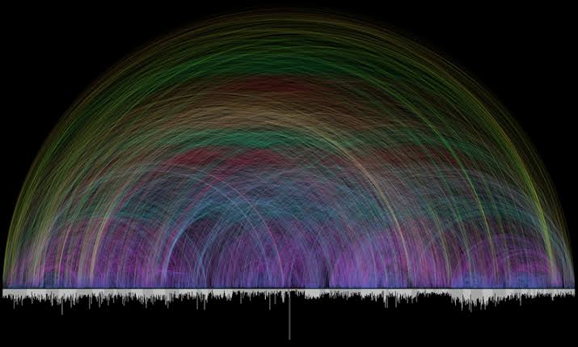

Goal:
- I am Roman Catholic and I want to make a website
- for non Catholics and not so catechised catholics to understand Catholic typology (from the sacraments, dogmas, mariology, eschatology, soteriology etc, essentially big Catholic concepts, additionally modern issues like contraception, IVF, LGBTQ, capital punishment, just war theory)
- end state i want audiences with various degrees of knowledge of theology to be able to understand why Catholics do certain things / believe in certain things, stemming from the old testament, church fathers, saints etc
- I want the design of the website to be modern and sleek, homepage to have a video running in the background like professional websites
- Other bonus features: at the nav bar on top, I want a tab for ppl to click on if theyre interested to know mnore about the faith, leading to the singapore catholic archdiocese website, other official resources like vatican website, papal bulls, official documents, catechism etc and most importantly, a map that tells the user where is the nearest catholic church to him/her

Context: this is an empty directory, i want you to make an empty repo 

In terms of tech stack: im not a frontend developer, im familiar with front end, more confident with backend and AI concepts, so you can suggest to me how you want this to be run

Actually i was thinking if there's a cheap way to host this on amazon 

Limitations: I want this to be a totally free or minimal to run 

Grill me like crazy to align on specs and design features, maybe you can come up with quick prototypes for me to approve what kind of designs i want

cool reference pic for cross references in the bible 
